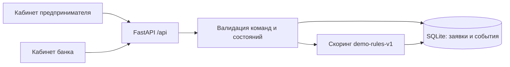
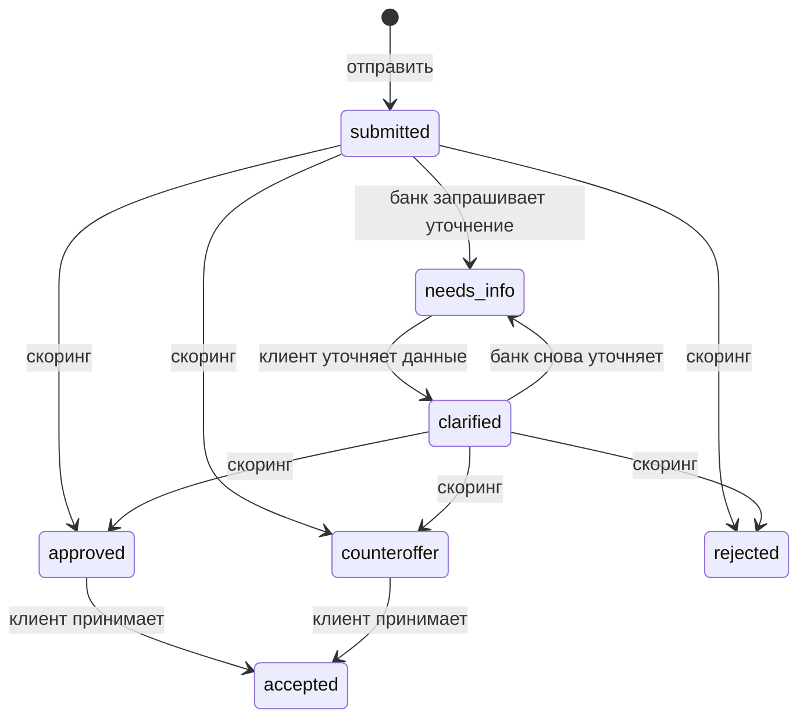

# Архитектура, данные и сценарии

## Контекст

Клиенту нужен быстрый понятный путь от потребности до условий; банку — проверяемое решение с управляемыми переходами. В MVP есть два представления одной заявки, серверная бизнес-логика и история событий. Роль в интерфейсе переключается без реальной аутентификации (строго демо).

## Компоненты

## Состояния заявки

## Data model

`applications`: id, created_at, updated_at, company, purpose, amount, months, available_cashflow, revenue, existing_payments, overdue, status, score, decision, alternative_amount, explanation (JSON с версией правил и факторами).

`events`: id, application_id, occurred_at, actor, action, description. Event history append-only на уровне приложения (не защищён от DBA в демо).

## Основной API

| Метод | Путь | Описание |
|---|---|---|
| GET | `/api/health` | Healthcheck |
| GET | `/api/applications` | Очередь |
| POST | `/api/applications` | Создать заявку |
| GET | `/api/applications/{id}` | Карточка с историей |
| POST | `/api/applications/{id}/request-info` | Запрос уточнения |
| POST | `/api/applications/{id}/clarify` | Ответ клиента |
| POST | `/api/applications/{id}/evaluate` | Скоринг и решение |
| POST | `/api/applications/{id}/accept` | Принятие предложения |
| POST | `/api/demo/reset` | Сброс тестовых данных |

OpenAPI: `/openapi.json`, Swagger: `/docs`.

## Упрощённые правила

Ежемесячный аннуитетный платёж при 22% годовых; платёжная нагрузка = `(новый платёж + существующие платежи) / доступный денежный поток`. Начальный балл 85; при нагрузке > 75% −40, > 60% −20; при просрочках −35; если сумма превышает 4 месячные выручки −15. При 65+ баллах одобрение, иначе без просрочек система ищет максимальную альтернативную сумму с нагрузкой не выше 60%, иначе отказ. Все коэффициенты вымышлены.

## Тестовые сценарии

1. Создание, одобрение, принятие.
2. Создание, запрос данных, уточнение, повторная оценка.
3. Создание, альтернативная сумма, принятие.
4. Отказ при высоком риске.
5. Невалидные параметры: HTTP 422.
6. Попытка повторного скоринга финальной заявки: HTTP 409.
7. Данные и события сохраняются между перезапусками.

## Следующая итерация, если останется время

Авторизация и права; безопасные интеграционные моки ФНС/БКИ; формализация объяснимости; отдельные финансовые сценарии по месяцам; проверяемый аудит; обработка ошибок внешних сервисов; показ метрик работы конвейера.
