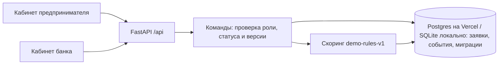
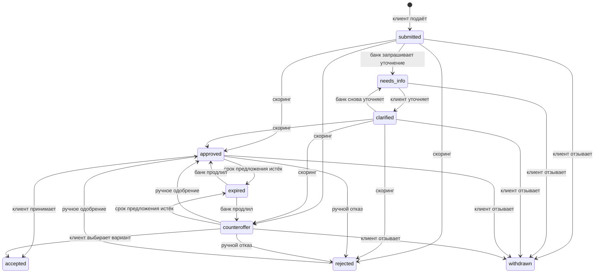

# Архитектура, данные и сценарии

## Контекст

Клиенту нужен быстрый понятный путь от потребности до условий; банку — проверяемое решение с управляемыми переходами. В MVP два представления одной заявки, серверная бизнес-логика и история событий. Роли разделены демонстрационными паролями и статическими токенами (строго демо, см. `limitations.md`).

## Компоненты

Серверный код разделён по обязанностям, циклических импортов нет:

| Модуль | Обязанность |
|---|---|
| `app/main.py` | Сборка приложения: журнал запросов и заголовки безопасности, единый формат ошибок валидации, статика, подключение обработчиков, запуск миграций |
| `app/handlers/applications.py` | Очереди, создание заявки, команды обеих ролей (`If-Match`, проверка роли и статуса) |
| `app/handlers/analytics.py` | Воронка по журналу событий, исходы предложений, ставки, SLA |
| `app/handlers/calculations.py` | Предварительная оценка, график платежей, симулятор — ничего не сохраняют |
| `app/handlers/system.py` | Вход, страницы `/` и `/split`, `/api/health`, `/api/ready`, заглушка ИНН |
| `app/handlers/live.py` | Живые обновления: изменения журнала после курсора, ответом или потоком SSE |
| `app/demo.py` | Синтетические сценарии и `/api/demo/*`; шаги выполняются настоящими обработчиками |
| `app/workflow.py` | Сервис переходов: чтение с ленивым истечением, `transition` с проверкой версии, выдача предложений, чей ход и SLA |
| `app/policy.py` | Правила demo-rules-v1: балл, вклад факторов, решение, альтернативы, советы, ставка по баллу |
| `app/schedules.py` | Аннуитетный платёж, график с досрочным погашением, сезонный сценарий |
| `app/schemas.py` | Pydantic-модели запросов и ответов, из них строится OpenAPI |
| `app/storage.py` | Соединение для Postgres и SQLite, часы, миграции, запись событий |
| `app/settings.py` | Переменные окружения и проверка секретов на публичных окружениях |
| `app/auth.py` | Демо-токены ролей |

`policy` и `schedules` не знают о базе и HTTP, поэтому правила и расчёты проверяются напрямую. Настройки читаются как `settings.X` в момент вызова, тесты меняют их через `monkeypatch`.
- `app/static/index.html` — разметка и стили; `app/static/app.js` — клиентская логика; `app/static/split.html` — два окна приложения во фреймах (`/?pane=client`, `/?pane=bank`), пересылает между ними выбор заявки через `postMessage`. Поэтому `X-Frame-Options: SAMEORIGIN`, а не `DENY`. Статика отдаётся с `?v=<хеш содержимого>` и кешируется навсегда; HTML и API — `no-store`.

## Состояния заявки

Ход: `submitted`, `clarified` — банк (SLA `BANK_SLA_HOURS`, по умолчанию 24 ч); `needs_info`, `approved`, `counteroffer` — клиент (предложение действует `OFFER_VALID_DAYS`, по умолчанию 7 дней). Истечение применяется лениво при чтении заявки.

## Согласованность изменений

- **Атомарные переходы.** У заявки есть `version`. Команда читает заявку, проверяет роль и статус, затем выполняет `UPDATE … SET …, version = version + 1 WHERE id = ? AND version = ?`. Если строку уже изменили, обновлено 0 строк: команда ничего не меняет и отвечает `409`. Событие пишется только после успешного обновления, в той же транзакции. Так работает на обоих движках: в Postgres второй `UPDATE` ждёт блокировку строки и после фиксации первого не находит прежнюю версию.
- **Версия карточки.** Клиент передаёт версию показанной заявки в `If-Match`; если заявку изменили после открытия карточки, ответ `409`. Без заголовка проверяется только конкуренция внутри запроса.
- **Идемпотентное создание.** `POST /api/applications` принимает `Idempotency-Key`. Повтор с тем же ключом возвращает уже созданную заявку (`200`, `Idempotency-Replayed: true`), тот же ключ с другими данными — `422`. Уникальный индекс защищает и от одновременных повторов.
- **Сохранённые предложения.** Скоринг выдаёт предложение (`explanation.offer` при одобрении, `explanation.offers` при контрпредложении) с `offer_id`, версией правил, суммой, сроком, ставкой, платежом и переплатой. `accept` принимает ровно сохранённые условия и не пересчитывает ставку; изменение тарифов действует только на новые предложения. Можно передать `offer_id`: если банк заменил предложение, ответ `409`. Ручное одобрение выпускает новое предложение (`basis: manual`).

## Data model

Схема ведётся миграциями (`schema_migrations`, текущая версия 2). По умолчанию они применяются при старте под advisory lock в Postgres; при `MIGRATE_ON_START=0` их выполняют отдельным шагом `python -m app.main migrate`, а `/api/ready` до этого отвечает `503`.

`applications`: id, created_at, updated_at, company, purpose, amount, months, available_cashflow, revenue, existing_payments, overdue, status, score, decision (автоматическое решение), alternative_amount, explanation (JSON), offer_expires_at, info_request (JSON), version, idempotency_key (уникальный), previous_id (повторная подача). В Postgres — `CHECK` допустимых статусов.

`events`: id, application_id, occurred_at, actor, action, description, data (JSON: решение, балл, offer_id, изменённые поля). Индекс `(application_id, id)` для истории; в Postgres — внешний ключ на `applications`. Журнал append-only на уровне приложения (не защищён от администратора БД в демо).

`explanation`:

| Поле | Смысл |
|---|---|
| `assessment` | Расчёт риска запрошенных условий: балл, исходный балл, базовая ставка 22%, платёж по ней, нагрузка, вклад каждого фактора |
| `requested` | Запрошенные условия: по ставке предложения при одобрении, иначе по базовой ставке |
| `offer` | Выданное предложение на запрошенных условиях (одобрение) |
| `offers` | Выданные альтернативы с собственными баллом и нагрузкой (контрпредложение) |
| `accepted_terms` | Условия, которые принял клиент, — копия выбранного предложения |
| `manual_override` | Ручное решение: решение, основание, автор (роль), время, исходный автоскоринг |

## Основной API

| Метод | Путь | Роль | Описание |
|---|---|---|---|
| POST | `/api/demo/login` | — | Вход, выдаёт токен роли |
| GET | `/api/health` | — | Liveness: процесс отвечает |
| GET | `/api/ready` | — | Readiness: `SELECT` из базы и актуальная схема, иначе `503` |
| POST | `/api/precheck` | клиент | Предварительная оценка по тем же правилам, ничего не сохраняет |
| POST | `/api/simulate` | любая | Остаток после платежей на 12 месяцев по графику погашения |
| POST | `/api/schedule` | любая | График платежей, досрочное погашение |
| GET | `/api/my-applications` | клиент | Заявки клиента |
| POST | `/api/applications` | клиент | Создать заявку (`Idempotency-Key`, `previous_id`) |
| GET | `/api/applications` | банк | Очередь с SLA |
| GET | `/api/applications/{id}` | любая | Карточка с историей и `version` |
| POST | `/api/applications/{id}/request-info` | банк | Запрос уточнения выбранных полей |
| POST | `/api/applications/{id}/clarify` | клиент | Ответ на уточнение |
| POST | `/api/applications/{id}/evaluate` | банк | Скоринг и выдача предложения |
| POST | `/api/applications/{id}/decision` | банк | Ручное одобрение или отказ с основанием |
| POST | `/api/applications/{id}/extend` | банк | Продление предложения, в том числе истёкшего |
| POST | `/api/applications/{id}/accept` | клиент | Принятие сохранённого предложения |
| POST | `/api/applications/{id}/withdraw` | клиент | Отзыв заявки |
| GET | `/api/changes` | любая | Изменения после курсора `?after=`: события журнала, новый курсор, `reset` — перечитать список |
| GET | `/api/changes/stream` | любая | То же потоком SSE: сразу текущее состояние, затем каждое изменение, через `STREAM_SECONDS` поток закрывается |
| GET | `/api/analytics` | банк | Воронка по истории событий, SLA, ставки; `?days=N` — когорта по дате подачи |
| POST/DELETE | `/api/demo/seed` | банк | Создать или удалить синтетические заявки `DEMO…` |
| GET | `/api/mock/company/{inn}` | любая | Заглушка проверки ИНН |
| POST | `/api/demo/reset` | банк | Сброс всех данных, только при `ENABLE_DEMO_RESET=1` |

Команды по заявке принимают `If-Match: <version>`. Ошибки валидации: `422` с `detail` (строка для человека) и `errors: [{field, message}]`. Каждый ответ несёт `X-Request-ID`; ответ `500` — JSON с тем же `request_id`.

OpenAPI: `/openapi.json`, Swagger: `/docs`, снимок — `docs/openapi.json` (обновление: `python scripts/export_openapi.py`; CI и тесты проверяют, что снимок актуален).

## Правила demo-rules-v1

Платёж считается по аннуитету по базовой ставке 22%; нагрузка = `(новый платёж + существующие платежи) / свободный денежный поток`. Исходный балл 85; нагрузка выше 75% −40, выше 60% −20; просрочки −35; сумма больше 4 месячных выручек −15. От 65 баллов — одобрение. Иначе без просрочек ищутся альтернативы с нагрузкой не выше 60%: наибольшая сумма с шагом 100 000 ₽ на тот же срок и кратчайший более долгий срок на ту же сумму; нет альтернатив — отказ. Ставка предложения зависит от балла: от 85 — 18%, от 70 — 20%, от 65 — 22%; ниже 65 — 26%, только при ручном одобрении. Все коэффициенты вымышлены.

## Аналитика

Воронка исторических этапов: заявка засчитывается в этап, если хоть раз его достигла по журналу событий (скоринг, выданное предложение — автоматически или вручную, принятие). Поздний ручной отказ не убирает выданное предложение из воронки. Текущие статусы — отдельно в `by_status`. SLA считается двумя способами: первый ответ банка (от подачи до первого скоринга или запроса уточнения) и каждый цикл (от подачи или уточнения до следующего действия банка). Ставки берутся из сохранённых предложений и принятых условий.

## Наблюдаемость

Для каждого запроса к `/api/` пишется JSON-строка в stdout: `request_id`, метод, путь, статус, длительность запроса и SQL. Необработанные исключения логируются с `request_id` и возвращаются клиенту как JSON. По логам считаются частота `409` и `5xx`; `/api/ready` подходит для мониторинга.

## Тесты

- `tests/test_flow.py` — основные сценарии: одобрение, уточнение, отказ, контрпредложения, ручное решение, срок предложения, демо-данные.
- `tests/test_concurrency.py` — конкурирующие команды (accept/accept, accept/withdraw, evaluate/request-info, extend/expire), устаревшая версия карточки, идемпотентное создание.
- `tests/test_offers_and_rules.py` — сохранённая цена предложения, пороги правил 0,60/0,75 и 4× выручка, закрытие графиков, горизонт симулятора, историческая воронка, повторная подача.
- `tests/test_contract.py` — формат ошибок, вход с кириллицей, readiness, повторяемые миграции, кеширование статики, актуальность OpenAPI и схемы ответов.

- `e2e/test_ui.py` — браузерные тесты на Playwright против настоящего процесса uvicorn с отдельной SQLite: основной сценарий, поздний ответ по прежней заявке (ответ задерживается через `page.route`), двойной клик по «Подать заявку», команда из устаревшей карточки.

CI прогоняет тесты на SQLite и Postgres, браузерные тесты, проверяет снимок OpenAPI, аудит зависимостей (`pip-audit`) и HTTP smoke.
